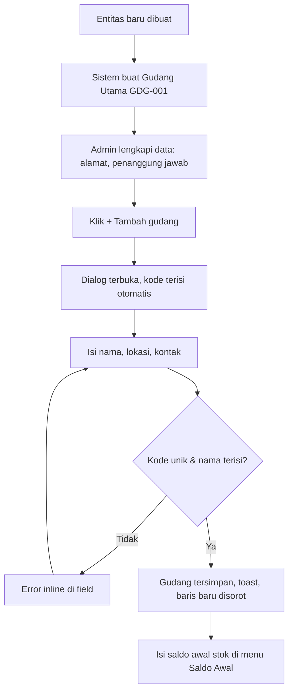
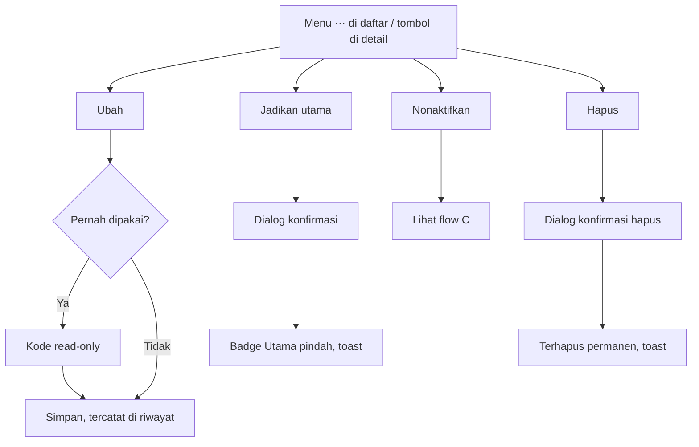
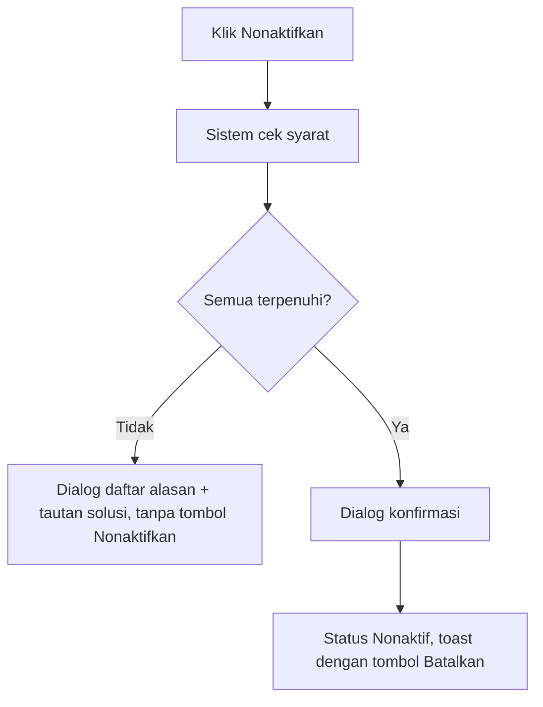

# Spesifikasi Fitur: Gudang

> Dokumen ini adalah acuan untuk membangun menu **Gudang** di aplikasi Jurnal ProApps. Saat ini halaman Gudang masih berupa placeholder "Modul ini sedang disiapkan". Ganti placeholder itu dengan fitur di bawah ini.

---

## 0. Aturan wajib untuk implementasi

1. **Pakai style dan komponen yang sudah ada di project.** Jangan membuat design system, token warna, font, atau komponen baru.
   - Sebelum menulis kode, pelajari dulu halaman yang sudah jadi (misalnya Aset Tetap, Kas & Bank, Penjualan, Pengaturan Syarat Pembayaran). Ikuti pola di sana: page header card (ikon + judul + deskripsi), tabel, filter, tombol, drawer/side sheet, dialog konfirmasi, badge status, toast, empty state, tab, menu aksi ⋯.
   - Kalau komponen yang dibutuhkan belum ada, susun dari komponen yang sudah ada. Jangan memasang library UI baru.
   - Ikuti konvensi routing, struktur folder, penamaan file, state management, dan cara penyimpanan data (mock/browser storage) yang sudah dipakai di project.
2. **Bahasa UI: Indonesia.** Pakai sentence case: "Tambah gudang", bukan "Tambah Gudang".
3. **Format angka dan tanggal** ikuti helper yang sudah ada (Rp 2.800.000, 4 Nov 2026).
4. **Ikon menu Gudang** tetap seperti yang sudah ada di sidebar.

---

## 1. Prinsip desain

**Gudang adalah master data lokasi, bukan tempat transaksi.**

- Saldo dan riwayat stok bersumber dari **Mutasi Stok**. Gudang hanya *menampilkan* data itu dengan filter gudangnya. Tidak ada sumber angka kedua.
- Stok tidak pernah diubah langsung dari menu Gudang. Stok hanya berubah lewat dokumen: penerimaan barang, pengeluaran, pindah barang, stok opname, atau saldo awal.

---

## 2. Aturan bisnis dan akuntansi

| No | Aturan | Alasan | Dampak ke UI |
|---|---|---|---|
| R1 | Sistem otomatis membuat **Gudang Utama** (kode `GDG-001`) saat entitas dibuat | Setiap mutasi stok wajib punya lokasi | Daftar gudang tidak pernah kosong |
| R2 | Selalu ada **tepat satu** gudang utama | Dipakai sebagai default di transaksi baru | Menjadikan gudang lain sebagai utama otomatis melepas yang lama |
| R3 | Gudang yang **pernah dipakai** di transaksi apa pun **tidak bisa dihapus**, hanya dinonaktifkan | Jejak audit | Aksi Hapus hanya tampil jika gudang belum pernah dipakai |
| R4 | **Kode gudang dikunci** setelah gudang dipakai di transaksi | Kode sudah tercetak di dokumen | Field kode read-only + helper text: "Kode terkunci karena sudah dipakai di transaksi". Nama tetap bisa diubah |
| R5 | Gudang hanya bisa dinonaktifkan jika: stok semua produk = 0, tidak ada PO yang belum diterima ke gudang ini, tidak ada stok opname yang sedang berjalan, dan bukan gudang utama | Saldo persediaan di neraca tidak boleh tertinggal di lokasi yang tidak bisa dipakai | Jika diblokir, tampilkan dialog daftar alasan beserta tautan solusinya |
| R6 | Gudang **tidak punya akun persediaan sendiri**. Akun ditentukan per kategori produk | Neraca memakai satu akun Persediaan, dan pindah antar gudang tidak mengubah nilai | Form gudang tidak punya field akun |
| R7 | **Saldo awal stok tidak diinput dari Gudang**, tetapi dari menu Saldo Awal | Saldo awal hanya sah per tanggal mulai memakai sistem | Tidak ada tombol "Isi stok" di Gudang |
| R8 | Semua perubahan data gudang dicatat: siapa, kapan, field, nilai sebelum → sesudah | Audit trail | Tab "Riwayat perubahan" di detail |
| R9 | Kolom **Nilai persediaan** hanya terlihat oleh peran yang berhak (Accounting/Admin) | Staf gudang cukup tahu qty | Sembunyikan kolom dan kartu nilai sesuai hak akses. Di prototipe, pakai flag `canViewInventoryValue` |
| R10 | Gudang **nonaktif** tidak muncul di dropdown transaksi baru, tetapi tetap muncul di filter laporan dan dokumen lama | Data historis tetap utuh | — |

### Definisi stok

- Stok = **qty per produk per gudang**. Gudang tidak punya satu angka stok.
- Qty **tidak boleh dijumlah antar produk**, karena satuannya berbeda (rim + pcs tidak bermakna). Yang boleh dijumlah hanya **nilai (Rp)**.
- **Jumlah item** = jumlah produk dengan qty > 0 di gudang itu.
- Qty disimpan dalam **satuan dasar**. Jika ada konversi, tampilkan keterangan, misalnya `240 pcs (20 dus)`.
- Hanya produk dengan **Lacak stok = ya** yang muncul. Jasa dan barang non-persediaan tidak muncul.
- **Nilai** = qty × harga rata-rata produk. Harga rata-rata dihitung **gabungan semua gudang**, sehingga transfer tidak mengubah nilai.
- **Stok minimum** diatur **per produk per gudang**.
  - Status: `Aman` jika qty ≥ minimum.
  - Status: `Di bawah minimum` jika qty < minimum.
  - Status: `Habis` jika qty = 0.

---

## 3. Information Architecture

```
Gudang
├── Daftar Gudang                          route: /warehouses (ikuti konvensi route project)
│   ├── Page header: ikon, "Gudang", "Kelola lokasi penyimpanan barang dan stok di tiap lokasi."
│   │   └── Tombol utama: [+ Tambah gudang]
│   ├── Kartu ringkasan: Gudang aktif · Total item · Nilai persediaan*
│   ├── Toolbar: filter Status (Aktif | Nonaktif | Semua; default Aktif) · cari kode/nama
│   ├── Tabel
│   │   ├── Kode
│   │   ├── Nama gudang  (+ badge "Utama")
│   │   ├── Kota
│   │   ├── Penanggung jawab
│   │   ├── Jumlah item           (rata kanan)
│   │   ├── Nilai persediaan*     (rata kanan)
│   │   ├── Status                (badge Aktif / Nonaktif)
│   │   └── Aksi ⋯ : Ubah · Jadikan utama · Nonaktifkan / Aktifkan · Hapus**
│   ├── Klik baris → Detail Gudang
│   └── Empty state hasil filter/cari: "Tidak ada gudang yang cocok"
│
├── Dialog Tambah / Ubah Gudang            (dialog di tengah layar, bukan halaman baru)
│   ├── Identitas
│   │   ├── Kode*           otomatis (GDG-00N), bisa diubah sebelum dipakai; unik
│   │   └── Nama gudang*    maks 100 karakter
│   ├── Lokasi:  Alamat · Kota · Kode pos
│   ├── Kontak:  Penanggung jawab (pilih user) · Telepon
│   ├── Catatan
│   ├── [ ] Jadikan gudang utama
│   └── Footer: [Batal] [Simpan]
│
└── Detail Gudang                          route: /warehouses/:id
    ├── Header: Nama · Kode · badge Utama / Nonaktif
    │   └── Aksi: [Ubah]  [Pindah barang]  ⋯ (Jadikan utama · Nonaktifkan / Aktifkan · Hapus**)
    ├── Kartu info: Alamat · Penanggung jawab · Telepon · Catatan · Dibuat oleh / tanggal
    ├── Kartu ringkasan: Jumlah item · Nilai persediaan* · Item di bawah minimum
    └── Tab
        ├── Stok (default)
        │   Kolom: Produk (nama + kode) · Qty · Satuan · Stok min. · Status · Nilai*
        │   Filter: cari produk · status stok
        │   Klik produk → Kartu stok di Mutasi Stok (filter produk + gudang)
        │   Aksi per baris ⋯ : Atur stok minimum (dialog 1 field, lihat bagian 5)
        │   Link: "Lihat di Mutasi Stok"
        ├── Mutasi terakhir
        │   20 mutasi terakhir: Tanggal · No. dokumen (link) · Jenis · Produk · Masuk · Keluar · Saldo
        │   Link: "Lihat semua di Mutasi Stok"
        └── Riwayat perubahan
            Waktu · Pengguna · Perubahan (field: sebelum → sesudah)

*  hanya tampil sesuai hak akses (R9)
** hanya tampil jika gudang belum pernah dipakai di transaksi (R3)
```

**Komponen Tab Stok dan Mutasi terakhir memakai sumber data yang sama dengan menu Mutasi Stok.** Jangan membuat perhitungan stok terpisah.

---

## 3a. Integrasi dengan Pembelian, Penjualan, dan Produk

**Prinsip:**
- Gudang hanya menyediakan *lokasi*. Di modul lain, gudang muncul sebagai **field pilihan gudang** pada dokumen.
- Stok baru bergerak lewat dokumen dan dicatat di Mutasi Stok. Integrasi yang menambah atau mengurangi stok **tidak** dibangun di fase ini.
- Aturan akuntansi: stok bergerak saat **barang fisik diterima atau dikirim**, bukan saat faktur dibuat.

### Aturan dropdown gudang (berlaku di semua modul)
- Pakai komponen select/combobox yang sudah ada di project.
- Opsi: gudang **aktif** saja, dengan format `Kode · Nama`. Gudang utama diberi label "Utama".
- Nilai default: **gudang utama**. Pengguna tetap boleh menggantinya per dokumen.
- Dokumen lama yang memakai gudang yang kini nonaktif tetap menampilkan gudang itu dengan label "(nonaktif)" saat dibuka. Gudang tersebut tidak bisa dipilih lagi untuk dokumen baru.
- Di filter laporan (Mutasi Stok dan laporan persediaan), gudang nonaktif tetap tampil, dengan label "(nonaktif)".

### Yang dibangun di fase Gudang (sekarang)

| Modul | Dokumen | Perubahan |
|---|---|---|
| Pembelian | FPPBJ | Field **Lokasi kirim** diganti menjadi dropdown gudang |
| Pembelian | Purchase Order | Tambah field **Kirim ke gudang**. Alamat gudang tampil di blok "Kirim ke" pada form dan cetakan PO |
| Penjualan | Pesanan Penjualan | Tambah field **Gudang asal** |
| Produk | Master produk | Tambah field **Lacak stok** (ya/tidak, default ya untuk jenis Barang, tidak untuk Jasa) dan **Satuan dasar**. Hanya produk dengan Lacak stok = ya yang tampil di tab Stok gudang |

Data ini dipakai oleh cek nonaktif R5: "PO belum diterima ke gudang ini" = PO berstatus belum diterima penuh dengan **Kirim ke gudang** = gudang tersebut.

### Yang dibangun nanti, bersama spesifikasi Mutasi Stok (jangan dibangun sekarang)

| Modul | Dokumen | Efek ke stok | Jurnal |
|---|---|---|---|
| Pembelian | Penerimaan Barang (dari PO) | Stok **masuk** ke gudang tujuan | Dr Persediaan / Cr Barang Diterima Belum Ditagih |
| Pembelian | Faktur Pembelian | Tidak menggerakkan stok, hanya dicocokkan dengan penerimaan | Dr Barang Diterima Belum Ditagih + PPN Masukan / Cr Hutang Usaha |
| Pembelian | Retur Pembelian | Stok **keluar** dari gudang | Dr Hutang Usaha / Cr Persediaan |
| Penjualan | Pengiriman / Faktur Penjualan | Stok **keluar**, ditolak jika stok tidak cukup | Dr HPP / Cr Persediaan |
| Penjualan | Retur Penjualan | Stok **masuk kembali** ke gudang yang dipilih | Dr Persediaan / Cr HPP |
| Penjualan | Penawaran | Tidak ada. Opsional: tampilkan info "stok tersedia" | — |
| Produk | Detail produk | Bagian **Stok per gudang** (hanya baca): qty, stok minimum, dan status di tiap gudang | — |
| Produk | Master produk | Satuan konversi (1 dus = 12 pcs), kategori → akun Persediaan/HPP | — |

---

## 4. User flow

### A. Setup awal dan tambah gudang



### B. Aksi pada gudang



### C. Nonaktifkan gudang



Syarat dan tautan solusi di dialog blokir:

| Kondisi gagal | Teks | Tautan |
|---|---|---|
| Masih ada stok | Masih ada stok **12 item** (Rp 4.250.000*) | [Pindah barang] |
| Ada PO terbuka | **2 PO** belum diterima ke gudang ini | [Lihat PO] |
| Opname berjalan | Stok opname **SO/2026/11/003** masih berjalan | [Buka opname] |
| Gudang utama | Ini gudang utama. Pilih gudang utama lain dulu | [Pilih gudang utama] |

### D. Aktifkan kembali
Filter Nonaktif → ⋯ Aktifkan → langsung aktif dengan toast "Gudang diaktifkan". Tidak perlu konfirmasi karena aman dan bisa dibalik.

### E. Menelusuri stok sampai jurnal
```
Daftar Gudang → klik baris → Detail tab Stok → klik produk
→ Kartu stok (Mutasi Stok) → klik mutasi → Dokumen asal → Jurnal
```

---

## 5. Validasi dan teks UI

### Form
| Field | Aturan | Pesan error |
|---|---|---|
| Kode | Wajib, unik, maks 20 karakter, huruf/angka/tanda hubung | "Kode wajib diisi" · "Kode GDG-002 sudah dipakai" |
| Nama gudang | Wajib, maks 100 karakter | "Nama gudang wajib diisi" |
| Telepon | Opsional, angka/+/-/spasi | "Format nomor telepon tidak valid" |

- Tombol Simpan tetap aktif. Validasi dijalankan saat Simpan diklik, lalu fokus pindah ke field pertama yang error.
- Kalau dialog ditutup saat ada perubahan yang belum disimpan, tampilkan konfirmasi "Buang perubahan?".

### Dialog
| Aksi | Judul | Isi | Tombol |
|---|---|---|---|
| Jadikan utama | Jadikan gudang utama? | Gudang utama pindah dari **{lama}** ke **{baru}**. Transaksi baru otomatis memakai {baru}. Transaksi lama tidak berubah. | Batal · Jadikan utama |
| Nonaktifkan (lolos) | Nonaktifkan {nama}? | Gudang ini tidak bisa dipilih di transaksi baru, tetapi tetap muncul di laporan dan riwayat. | Batal · Nonaktifkan |
| Nonaktifkan (blokir) | {nama} belum bisa dinonaktifkan | Selesaikan hal berikut dulu: (daftar alasan) | Tutup |
| Hapus | Hapus {nama}? | Gudang ini akan dihapus permanen. Tindakan ini tidak bisa dibatalkan. | Batal · Hapus (gaya destructive) |
| Atur stok minimum | Stok minimum {produk} | Field angka "Stok minimum di {gudang}" + satuan dasar. Boleh 0 atau kosong (= tidak dipantau). Tidak boleh negatif. Perubahan tercatat di Riwayat perubahan | Batal · Simpan |

### Toast
- "Gudang {nama} ditambahkan"
- "Perubahan disimpan"
- "{nama} sekarang gudang utama"
- "{nama} dinonaktifkan" + [Batalkan]
- "{nama} diaktifkan"
- "{nama} dihapus"

---

## 6. Model data (prototipe)

```ts
type Warehouse = {
  id: string;
  code: string;             // "GDG-001", unik per entitas
  name: string;
  address?: string;
  city?: string;
  postalCode?: string;
  picUserId?: string;       // penanggung jawab
  phone?: string;
  notes?: string;
  isDefault: boolean;       // tepat satu true per entitas
  status: "active" | "inactive";
  createdBy: string;
  createdAt: string;
  updatedAt: string;
};

// Dibaca dari sumber yang sama dengan Mutasi Stok (bukan disimpan di Warehouse)
type StockBalance = {
  productId: string;
  warehouseId: string;
  qty: number;              // satuan dasar
  minQty?: number;          // stok minimum per produk per gudang
};

type WarehouseAuditLog = {
  id: string;
  warehouseId: string;
  userId: string;
  at: string;
  changes: { field: string; from: unknown; to: unknown }[];
};
```

Field turunan:
- `hasTransactions(warehouseId)`: true jika gudang pernah dipakai di dokumen mana pun. Dipakai oleh R3 dan R4.
- `itemCount` = jumlah produk dengan qty > 0.
- `inventoryValue` = Σ(qty × harga rata-rata produk).

### Mock data
| Kode | Nama | Kota | Status | Utama | Catatan |
|---|---|---|---|---|---|
| GDG-001 | Gudang Utama | Jakarta | Aktif | Ya | Stok: Kertas A4 80 gsm 50 rim (min 20), Map plastik 200 pcs (min 250) |
| GDG-002 | Gudang Lt. 2 | Jakarta | Aktif | Tidak | Stok: Kertas A4 80 gsm 10 rim. Pernah dipakai |
| GDG-003 | Gudang Lt. 3 | Jakarta | Aktif | Tidak | Belum pernah dipakai, stok kosong. Untuk tes Hapus |
| GDG-004 | Gudang Lama | Bekasi | Nonaktif | Tidak | Pernah dipakai, stok 0 |

---

## 7. Kriteria penerimaan

- [ ] Placeholder "Modul ini sedang disiapkan" diganti dengan Daftar Gudang.
- [ ] Semua UI memakai komponen dan style yang sudah ada. Tidak ada warna, font, atau komponen baru.
- [ ] Daftar menampilkan kartu ringkasan, filter status (default Aktif), pencarian, dan tabel sesuai IA.
- [ ] Tambah gudang lewat dialog: kode terisi otomatis, validasi kode unik dan nama wajib.
- [ ] Ubah gudang: kode read-only jika gudang pernah dipakai, dan perubahan masuk Riwayat perubahan.
- [ ] Hanya ada satu gudang utama. Jadikan utama memindahkan badge setelah konfirmasi.
- [ ] Nonaktifkan memeriksa keempat syarat (R5). Jika gagal, tampil dialog alasan dengan tautan solusi. Jika lolos, minta konfirmasi lalu tampilkan toast dengan Batalkan.
- [ ] Gudang nonaktif bisa diaktifkan kembali tanpa konfirmasi.
- [ ] Aksi Hapus hanya tampil untuk gudang yang belum pernah dipakai, dengan dialog destructive.
- [ ] Detail Gudang menampilkan header, kartu info, ringkasan, serta tab Stok, Mutasi terakhir, dan Riwayat perubahan.
- [ ] Tab Stok: qty tidak dijumlah antar produk, status stok minimum tampil, dan klik produk membuka kartu stok.
- [ ] Kolom dan kartu nilai tersembunyi saat `canViewInventoryValue = false`.
- [ ] Stok minimum bisa diatur per produk per gudang lewat aksi baris di tab Stok, dan status stok langsung berubah.
- [ ] FPPBJ (Lokasi kirim), PO (Kirim ke gudang), dan Pesanan Penjualan (Gudang asal) memakai dropdown gudang: default gudang utama, hanya gudang aktif.
- [ ] Master produk punya field Lacak stok dan Satuan dasar. Produk Jasa / Lacak stok = tidak tidak tampil di tab Stok.
- [ ] Gudang nonaktif tidak muncul di dropdown transaksi baru.
- [ ] Tidak ada tombol untuk mengubah stok langsung dari menu Gudang.
- [ ] Tampilan rapi di desktop dan tetap bisa dipakai di layar sempit: tabel bisa scroll horizontal, dialog jadi full width.

---

## 8. Di luar cakupan (jangan dibangun sekarang)

- Rak/bin di dalam gudang
- Akun persediaan per gudang
- Form Pindah Barang. Tombol "Pindah barang" cukup mengarah ke route/menu-nya. Kalau belum ada, tampilkan placeholder yang sama dengan modul lain.
- Isi menu Mutasi Stok dan Stok Opname. Kedua menu dirancang terpisah.
- Pergerakan stok dari dokumen (penerimaan, pengiriman, faktur, retur) beserta jurnal HPP/Persediaan. Lihat tabel "nanti" di bagian 3a.
- Batch/kedaluwarsa dan nomor seri
