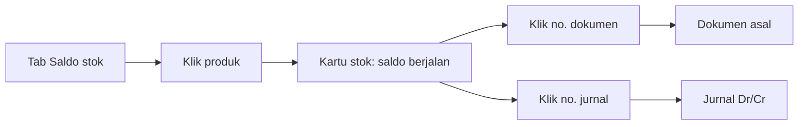
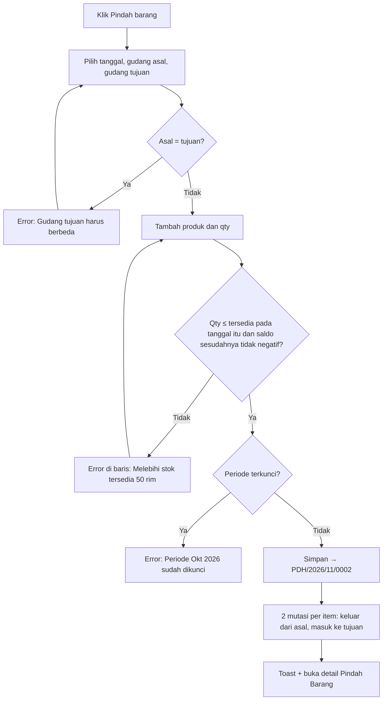
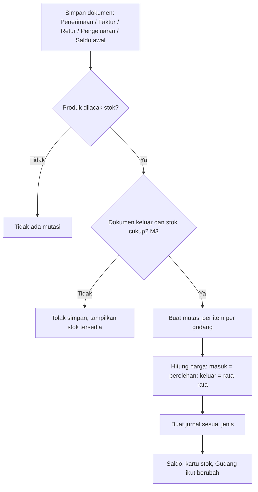
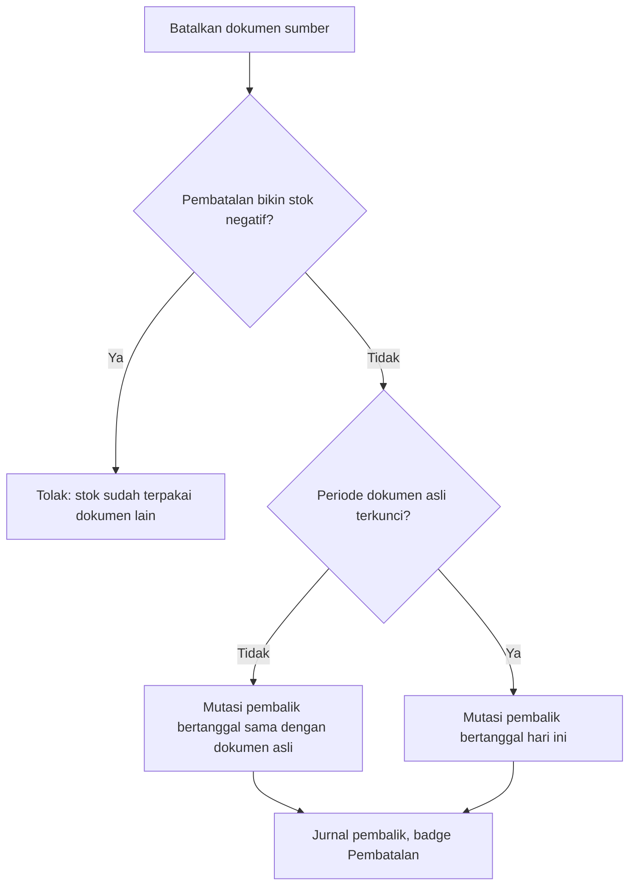

# Spesifikasi Fitur: Mutasi Stok

> Acuan untuk membangun menu **Mutasi Stok** di aplikasi Jurnal ProApps. Saat ini halamannya masih placeholder "Halaman ini belum dibangun".
>
> Dokumen ini lanjutan dari `gudang-spec.md`. Gudang adalah master lokasi, sedangkan **Mutasi Stok adalah buku besar persediaan**: satu-satunya sumber angka saldo stok, kartu stok, dan nilai persediaan.

---

## 0. Aturan wajib untuk implementasi

1. **Pakai style dan komponen yang sudah ada di project.** Jangan membuat design system, token warna, font, komponen, atau library UI baru.
   - Ikuti pola halaman yang sudah jadi, terutama **Gudang** (page header card, kartu ringkasan, toolbar filter, tabel, badge, menu ⋯, dialog, drawer, toast, tab) dan halaman daftar dokumen di Pembelian/Penjualan.
   - Ikuti konvensi routing (hash route), struktur folder, penamaan file, state management, penyimpanan data, dan helper format angka/tanggal yang sudah ada.
2. **Satu sumber data.** Semua angka stok di aplikasi harus dihitung dari kumpulan mutasi yang sama, lewat fungsi yang sama. Ini berlaku untuk tab Stok dan Mutasi terakhir di Gudang, Mutasi Stok, dan nanti Stok Opname serta detail produk. Jangan ada seed saldo terpisah yang bisa berbeda dari mutasinya.
3. Bahasa UI Indonesia dengan sentence case.

---

## 1. Prinsip desain

- **Mutasi tidak pernah diinput manual.** Setiap baris mutasi lahir dari dokumen: saldo awal, penerimaan barang, pengeluaran, pindah barang, faktur/retur, atau stok opname.
- **Mutasi tidak bisa diubah atau dihapus.** Koreksi dilakukan dengan membatalkan dokumen asalnya, yang akan membuat mutasi pembalik.
- Setiap angka bisa **ditelusuri**: saldo → kartu stok → dokumen asal → jurnal.
- Halaman ini terutama untuk **membaca**. Satu-satunya transaksi yang dibuat dari sini adalah **Pindah Barang**, karena dokumen itu memang milik persediaan, bukan milik Pembelian atau Penjualan.

---

## 2. Aturan bisnis dan akuntansi

| No | Aturan | Alasan | Dampak ke UI |
|---|---|---|---|
| M1 | Mutasi hanya dibuat oleh dokumen sumber. Tidak ada form "tambah mutasi" | Setiap perubahan stok harus punya bukti transaksi | Tidak ada tombol tambah, ubah, atau hapus di daftar mutasi |
| M2 | Mutasi tidak bisa diubah atau dihapus. Membatalkan dokumen menghasilkan **mutasi pembalik**. Jika periode dokumen asli masih terbuka, pembalik bertanggal sama dengan dokumen asli. Jika sudah dikunci, pembalik bertanggal hari pembatalan | Jejak audit; periode yang dikunci tidak boleh berubah | Mutasi pembalik tampil dengan badge "Pembatalan" dan tautan ke mutasi aslinya |
| M3 | **Stok tidak boleh negatif** pada tanggal mana pun, per produk per gudang. Dokumen keluar yang bertanggal mundur juga dicek: saldo sesudahnya tidak boleh jadi negatif | Barang yang tidak ada tidak bisa dikeluarkan | Dokumen sumber menolak simpan dengan pesan: "Stok {produk} di {gudang} pada {tanggal} hanya {qty} {satuan}" |
| M4 | Penilaian memakai **rata-rata tertimbang bergerak per produk, gabungan semua gudang** | Lebih sederhana dan umum dipakai. Pindah gudang tidak mengubah nilai | Kolom "Harga rata-rata" sama untuk satu produk di semua gudang |
| M5 | **Harga masuk** = harga perolehan per satuan dasar: DPP setelah diskon, **tanpa PPN Masukan** (PPN dicatat sebagai pajak, bukan biaya barang). Harga untuk saldo awal diisi pada dokumen saldo awal | Kaidah biaya perolehan persediaan | — |
| M6 | **Harga keluar** = harga rata-rata pada saat mutasi itu terjadi. Pindah barang: nilai keluar dari gudang asal sama dengan nilai masuk ke gudang tujuan | — | — |
| M7 | Urutan mutasi: **tanggal dokumen**, lalu **waktu posting** | Saldo berjalan harus konsisten | Kartu stok diurutkan dengan aturan ini |
| M8 | Dokumen bertanggal mundur hanya boleh di **periode yang belum dikunci** (pakai Kunci Periode / Tutup Buku yang sudah ada). Kalau diizinkan, harga rata-rata dan nilai mutasi keluar sesudahnya dihitung ulang, dan jurnalnya ikut diperbarui | Periode yang sudah dikunci tidak boleh berubah | Peringatan sebelum simpan: "Tanggal ini lebih awal dari mutasi terakhir. Nilai {n} mutasi sesudahnya akan dihitung ulang." |
| M9 | Qty selalu disimpan dalam **satuan dasar**. Konversi dari satuan lain dilakukan di dokumen sumber | Qty antar dokumen bisa dibandingkan | Tampilkan satuan dasar. Opsional: tambahkan keterangan konversi |
| M10 | **Total nilai persediaan harus sama dengan saldo akun Persediaan** di buku besar pada tanggal yang sama | Rekonsiliasi subledger dengan GL | Indikator "Cocok dengan buku besar" atau "Selisih Rp x" di tab Saldo stok |
| M11 | Kolom harga dan nilai hanya tampil untuk peran yang berhak | Sama dengan R9 di Gudang | Pakai flag `canViewInventoryValue` yang sama |
| M12 | Hanya produk dengan **Lacak stok = ya** yang punya mutasi | Jasa dan non-stok tidak punya persediaan | — |
| M13 | Selisih harga antara faktur pembelian dan penerimaan (versi 1) dibukukan ke akun **Selisih Harga Pembelian**. Nilai persediaan tidak diubah | Lebih sederhana. Penyesuaian ke persediaan ditunda | — |

### Jenis mutasi dan jurnal

| Jenis | Kode dok. | Arah | Jurnal otomatis |
|---|---|---|---|
| Saldo awal | SA | Masuk | Dr Persediaan / Cr Ekuitas Saldo Awal |
| Penerimaan barang | FPB | Masuk | Dr Persediaan / Cr Barang Diterima Belum Ditagih |
| Retur pembelian | RB | Keluar | Dr Hutang Usaha (atau Barang Diterima Belum Ditagih jika belum ditagih) / Cr Persediaan |
| Pengeluaran internal | PB | Keluar | Dr Beban (sesuai kategori produk / departemen) / Cr Persediaan |
| Penjualan | FJ | Keluar | Dr HPP / Cr Persediaan |
| Retur penjualan | RJ | Masuk | Dr Persediaan / Cr HPP |
| Pindah keluar | PDH | Keluar | Tidak ada jurnal (akun persediaan sama) |
| Pindah masuk | PDH | Masuk | Tidak ada jurnal |
| Penyesuaian opname (lebih) | SO | Masuk | Dr Persediaan / Cr akun sesuai alasan (lihat `stok-opname-spec.md` O10) |
| Penyesuaian opname (kurang) | SO | Keluar | Dr akun sesuai alasan (Rusak/Kedaluwarsa, Hilang, Salah catat; lihat `stok-opname-spec.md` O10) / Cr Persediaan |
| Pembatalan | sesuai dok. asal | Kebalikan dari aslinya | Jurnal pembalik |

- Akun Persediaan, Beban, dan HPP diambil dari **kategori produk**.
- Kode dokumen di atas hanya contoh. Ikuti Penomoran Dokumen yang sudah ada di Pengaturan.
- Penjualan tidak punya dokumen Pengiriman, jadi **Faktur Penjualan** yang mengeluarkan stok. Kalau nanti dibuat dokumen Pengiriman, pindahkan efek stoknya ke sana.

---

## 3. Information Architecture

```
Mutasi Stok
├── Page header: ikon, "Mutasi Stok", "Saldo dan riwayat barang masuk, keluar, dan berpindah di semua gudang."
│   └── Aksi: [Pindah barang] (tombol utama) · [Ekspor] (secondary, CSV)
│
├── Tab Saldo stok (default)
│   ├── Kartu ringkasan: Nilai persediaan* · Produk dilacak · Di bawah minimum · Habis
│   ├── Indikator rekonsiliasi*: "Cocok dengan buku besar (1-xxxx Persediaan)" atau "Selisih Rp x" → [Lihat buku besar]
│   ├── Toolbar: Saldo per (tanggal, default hari ini) · Gudang (Semua | per gudang) ·
│   │           Kategori · Status stok (Semua | Aman | Di bawah minimum | Habis) · Cari produk/SKU
│   ├── Tabel jika Gudang = Semua (matriks)
│   │   Produk (nama + SKU) · Satuan · [kolom qty per gudang aktif] · Total qty ·
│   │   Harga rata-rata* · Nilai*
│   │   Footer: Total nilai*
│   ├── Tabel jika satu gudang dipilih
│   │   Produk · Satuan · Qty · Stok min. · Status · Harga rata-rata* · Nilai*
│   ├── Klik produk / angka qty → Kartu stok (produk + gudang tersebut, atau Semua)
│   └── Empty state: "Belum ada stok. Stok bertambah saat barang diterima atau saldo awal diisi."
│
├── Tab Riwayat mutasi
│   ├── Toolbar: Periode (default bulan berjalan) · Gudang · Produk · Jenis mutasi (multi) · Cari no. dokumen
│   ├── Tabel (urut tanggal terbaru)
│   │   Tanggal · No. dokumen (link ke dokumen asal) · Jenis (badge) · Produk · Gudang ·
│   │   Masuk · Keluar · Harga satuan* · Nilai* · Jurnal (link no. jurnal)
│   ├── Baris pembatalan: badge "Pembatalan" + tautan "Membatalkan {no. dokumen}"
│   └── Footer: Total masuk · Total keluar (per satuan, hanya jika filter = 1 produk) · Total nilai*
│
├── Kartu stok                                route: …/kartu?produk=:id&gudang=:id|semua
│   ├── Header: nama produk + SKU · satuan dasar · kategori
│   │   └── Aksi: [Cetak] [Ekspor] · tombol kembali ke asal (Gudang / Mutasi Stok)
│   ├── Toolbar: Gudang (Semua | per gudang) · Periode (default awal tahun s.d. hari ini)
│   ├── Ringkasan: Saldo awal periode · Total masuk · Total keluar · Saldo akhir (qty + nilai*)
│   └── Tabel (urut tanggal lama ke baru, sesuai M7)
│       Baris pertama: "Saldo awal per {tanggal}"
│       Tanggal · No. dokumen · Jenis · Gudang (jika Semua) · Masuk · Keluar · Saldo qty ·
│       Harga satuan* · Nilai mutasi* · Saldo nilai* · Harga rata-rata*
│       Baris terakhir: "Saldo akhir per {tanggal}"
│
└── Pindah Barang
    ├── Form (drawer lebar atau halaman, ikuti pola form dokumen yang ada)
    │   ├── Tanggal* (default hari ini) · No. dokumen (otomatis, PDH/yyyy/mm/nnnn)
    │   ├── Gudang asal* · Gudang tujuan* (≠ asal; hanya gudang aktif)
    │   ├── Tabel item: Produk* (hanya yang stoknya > 0 di gudang asal pada tanggal itu) ·
    │   │              Tersedia · Qty* · Satuan · [hapus baris]   + [Tambah produk]
    │   ├── Catatan
    │   └── Footer: [Batal] [Simpan]
    ├── Detail Pindah Barang
    │   Header: no. dokumen · tanggal · badge status (Selesai / Dibatalkan)
    │   Info: gudang asal → gudang tujuan · dibuat oleh · catatan
    │   Tabel item: Produk · Qty · Satuan · Nilai*
    │   Mutasi yang dihasilkan (2 baris per item) dengan tautan ke kartu stok
    │   Aksi ⋯: Batalkan (membuat mutasi pembalik, M2) · Cetak
    └── Daftar pindah barang = Riwayat mutasi dengan filter Jenis = Pindah

*  sesuai hak akses (M11)
```

### Hubungan dengan menu lain

| Dari | Ke Mutasi Stok |
|---|---|
| Gudang → tab Stok | Komponen yang sama dengan tab Saldo stok (filter satu gudang). Klik produk membuka Kartu stok |
| Gudang → tab Mutasi terakhir | Komponen Riwayat mutasi (filter gudang, 20 baris). "Lihat semua" membuka tab Riwayat mutasi dengan filter gudang |
| Gudang → tombol Pindah barang | Membuka form Pindah Barang dengan gudang asal sudah terisi |
| Gudang → dialog blokir nonaktif → "Pindah barang" | Form Pindah Barang dengan gudang asal terisi dan semua produk yang stoknya > 0 sudah dimasukkan dengan qty penuh |
| Pembelian → Penerimaan Barang/Jasa | Simpan membuat mutasi masuk. Detail penerimaan menampilkan tautan "Lihat mutasi" |
| Penjualan → Faktur / Retur | Simpan membuat mutasi keluar/masuk dan jurnal HPP |
| Produk → detail | Bagian "Stok per gudang" (komponen Saldo stok, filter produk). Klik baris membuka Kartu stok |
| Produk → master | Lacak stok, Satuan dasar, dan Kategori (→ akun Persediaan/Beban/HPP) menentukan apakah dan bagaimana mutasi dibuat dan dijurnal |
| Kategori Produk | Tempat mengatur akun Persediaan, Beban, dan HPP per kategori. Dibaca setiap kali mutasi membuat jurnal |
| Saldo Awal | Dokumen SA membuat mutasi masuk per produk per gudang |
| Stok Opname (spesifikasi terpisah) | Membaca saldo buku dari sini. Posting penyesuaian membuat mutasi SO |

---

## 4. User flow

### A. Menelusuri angka stok



### B. Pindah barang



### C. Dokumen sumber membuat mutasi (otomatis)



### D. Membatalkan dokumen



Contoh untuk B1: penerimaan 50 rim dibatalkan, padahal 30 rim sudah dikeluarkan. Pembatalan ditolak dengan pesan: "Tidak bisa dibatalkan. 30 rim dari penerimaan ini sudah dipakai. Batalkan dulu dokumen keluarnya atau buat retur pembelian."

### E. Rekonsiliasi dengan buku besar

```
Tab Saldo stok → indikator rekonsiliasi
├─ Cocok → teks hijau "Cocok dengan buku besar"
└─ Selisih → teks peringatan "Selisih Rp x dengan akun Persediaan" → [Lihat buku besar]
   Penyebab umum: jurnal manual ke akun Persediaan. Tampilkan tip:
   "Akun Persediaan sebaiknya hanya diisi lewat dokumen persediaan."
```

---

## 5. Validasi dan teks UI

### Form Pindah Barang
| Field | Aturan | Pesan error |
|---|---|---|
| Tanggal | Wajib, tidak di periode terkunci, tidak di masa depan | "Periode {bulan} sudah dikunci" · "Tanggal tidak boleh melewati hari ini" |
| Gudang asal | Wajib, aktif | "Pilih gudang asal" |
| Gudang tujuan | Wajib, aktif, ≠ asal | "Gudang tujuan harus berbeda dari gudang asal" |
| Item | Minimal 1 baris, produk tidak boleh dobel | "Tambahkan minimal satu produk" · "Produk ini sudah ada di daftar" |
| Qty | > 0, ≤ tersedia (M3) | "Qty harus lebih dari 0" · "Melebihi stok tersedia ({qty} {satuan})" |

- Tombol Simpan tetap aktif. Validasi dijalankan saat diklik, lalu fokus pindah ke error pertama.
- Kolom **Tersedia** ikut diperbarui saat tanggal atau gudang asal diganti.
- Mengganti gudang asal saat item sudah terisi memunculkan konfirmasi "Daftar produk akan dikosongkan".

### Dialog
| Aksi | Judul | Isi | Tombol |
|---|---|---|---|
| Batalkan pindah barang | Batalkan {no}? | Stok kembali ke {asal}. Mutasi pembatalan dicatat, mutasi asli tetap ada di riwayat. | Kembali · Batalkan pindah barang (destructive) |
| Simpan dengan tanggal mundur | Hitung ulang nilai? | Tanggal ini lebih awal dari mutasi terakhir {produk}. Nilai {n} mutasi sesudahnya dan jurnalnya akan dihitung ulang. | Ubah tanggal · Tetap simpan |

### Toast
- "{no} disimpan. {n} produk dipindah ke {tujuan}"
- "{no} dibatalkan"
- "Ekspor disiapkan" (setelah file terunduh)

Hindari judul toast "Berhasil". Isi toast sudah cukup.

---

## 6. Model data (prototipe)

```ts
type StockMoveType =
  | "opening" | "receipt" | "purchase_return" | "issue"
  | "sale" | "sale_return" | "transfer_out" | "transfer_in"
  | "opname_gain" | "opname_loss";

type StockMove = {
  id: string;
  date: string;               // tanggal dokumen (YYYY-MM-DD)
  postedAt: string;           // waktu posting, untuk urutan di tanggal yang sama (M7)
  type: StockMoveType;
  productId: string;
  warehouseId: string;
  qtyIn: number;              // satuan dasar, >= 0
  qtyOut: number;             // satuan dasar, >= 0
  unitCost: number;           // masuk: harga perolehan; keluar: dihitung (M6)
  sourceType: string;         // "stock_opening" | "goods_receipt" | "stock_transfer" | ...
  sourceId: string;
  sourceNo: string;           // "FPB/2026/11/0002"
  journalId?: string;
  reversalOfId?: string;      // diisi pada mutasi pembalik
  isReversed?: boolean;
  createdBy: string;
};

type StockTransfer = {
  id: string;
  no: string;                 // PDH/2026/11/0001
  date: string;
  fromWarehouseId: string;
  toWarehouseId: string;
  lines: { productId: string; qty: number }[];
  notes?: string;
  status: "done" | "cancelled";
  createdBy: string;
  createdAt: string;
};
```

### Fungsi bersama (satu modul, dipakai semua halaman)

```ts
listMoves(filter)                              // riwayat, sudah terurut M7
getBalance(productId, warehouseId | "all", asOfDate)   // qty
getAverageCost(productId, asOfDate)            // rata-rata bergerak gabungan (M4)
getStockCard(productId, warehouseId | "all", from, to) // baris + saldo berjalan
getInventoryValue(warehouseId | "all", asOfDate)
canIssue(productId, warehouseId, date, qty)    // cek M3 termasuk saldo sesudahnya
```

- Saldo dan nilai **dihitung dari mutasi** (urutkan, lalu akumulasi). Jangan disimpan sebagai angka lepas.
- Hapus seed saldo terpisah (misalnya `stockBalancesSeed`) dan ganti dengan seed mutasi. Tab Stok di Gudang membaca `getBalance`.

### Seed mutasi (harus konsisten)

Data ini sekaligus memperbaiki temuan saldo Kertas A4 yang tidak nyambung.

| Tanggal | Dokumen | Jenis | Produk | Gudang | Masuk | Keluar | Harga | Saldo gudang |
|---|---|---|---|---|---|---|---|---|
| 5 Jan 2026 | SA/2026/01/0001 | Saldo awal | Kertas A4 80 gsm | Gudang Utama | 40 | | 56.000 | 40 |
| 5 Jan 2026 | SA/2026/01/0001 | Saldo awal | Map plastik | Gudang Utama | 150 | | 3.500 | 150 |
| 8 Jul 2026 | FPB/2026/07/0019 | Penerimaan | Kertas A4 80 gsm | Gudang Utama | 40 | | 56.000 | 80 |
| 5 Agu 2026 | FPB/2026/08/0024 | Penerimaan | Map plastik | Gudang Utama | 100 | | 3.500 | 250 |
| 14 Sep 2026 | FPB/2026/09/0028 | Penerimaan | Kertas A4 80 gsm | Gudang Utama | 50 | | 56.000 | 130 |
| 30 Sep 2026 | PB/2026/09/0004 | Pengeluaran | Kertas A4 80 gsm | Gudang Utama | | 45 | 56.000 | 85 |
| 15 Okt 2026 | PB/2026/10/0006 | Pengeluaran | Map plastik | Gudang Utama | | 50 | 3.500 | 200 |
| 16 Okt 2026 | PB/2026/10/0007 | Pengeluaran | Kertas A4 80 gsm | Gudang Utama | | 25 | 56.000 | 60 |
| 2 Nov 2026 | PDH/2026/11/0001 | Pindah keluar | Kertas A4 80 gsm | Gudang Utama | | 10 | 56.000 | 50 |
| 2 Nov 2026 | PDH/2026/11/0001 | Pindah masuk | Kertas A4 80 gsm | Gudang Lt. 2 | 10 | | 56.000 | 10 |

- Pertahankan mutasi produk lain yang sudah ada (Tinta printer, Kain pel, Cairan pembersih, Elbow PVC, Pipa PVC) asalkan saldo berjalannya konsisten.
- Hasil akhir harus sama dengan yang tampil di Gudang sekarang: Kertas 50 rim di Gudang Utama dan 10 rim di Lt. 2, Map plastik 200 pcs.

---

## 7. Kriteria penerimaan

- [ ] Placeholder Mutasi Stok diganti dengan tab Saldo stok (default) dan Riwayat mutasi.
- [ ] Semua UI memakai komponen dan style yang sudah ada. Tidak ada warna, font, atau komponen baru.
- [ ] Ada satu modul fungsi stok (bagian 6) yang dipakai oleh Mutasi Stok, tab Stok dan Mutasi terakhir di Gudang, ringkasan Gudang, dan detail Produk. Tidak ada seed saldo terpisah.
- [ ] **Produk, detail:** ada bagian "Stok per gudang" (hanya baca) untuk produk dengan Lacak stok = ya. Kolomnya: Gudang · Qty · Stok min. · Status, plus Harga rata-rata* dan Nilai*. Total qty di baris bawah. Klik baris membuka Kartu stok produk itu di gudang tersebut. Produk Lacak stok = tidak menampilkan teks "Stok tidak dilacak untuk produk ini".
- [ ] **Produk, master:** setiap produk Lacak stok = ya punya Satuan dasar dan Kategori. Kategori menentukan akun Persediaan, Beban, dan HPP yang dipakai jurnal mutasi. Jika akun kategori belum diatur, dokumen yang membuat mutasi ditolak dengan pesan "Akun persediaan untuk kategori {kategori} belum diatur" dan tautan ke Kategori Produk.
- [ ] **Produk, ubah:** Lacak stok tidak bisa diubah dari ya ke tidak selama produk masih punya saldo di gudang mana pun. Satuan dasar terkunci setelah produk punya mutasi.
- [ ] **Gudang ↔ Mutasi Stok:** "Lihat di Mutasi Stok" dan "Lihat semua" dari Gudang membuka Mutasi Stok dengan filter gudang itu sudah terpasang. "Kembali" di Kartu stok kembali ke halaman asal (Gudang atau Mutasi Stok).
- [ ] Tab Saldo stok:
  - mode matriks saat Gudang = Semua, dan mode daftar saat satu gudang dipilih;
  - filter "Saldo per" tanggal mengubah angka sesuai mutasi sampai tanggal itu;
  - total nilai sama dengan Σ nilai baris.
- [ ] Indikator rekonsiliasi membandingkan total nilai dengan saldo akun Persediaan pada tanggal yang sama.
- [ ] Tab Riwayat mutasi:
  - filter periode, gudang, produk, jenis, dan no. dokumen berfungsi;
  - no. dokumen dan no. jurnal bisa diklik.
- [ ] Kartu stok:
  - ada baris saldo awal periode dan saldo akhir;
  - saldo berjalan qty dan nilai benar;
  - urutan mengikuti M7;
  - pilihan gudang "Semua" menampilkan kolom Gudang.
- [ ] Pindah barang:
  - validasi pada bagian 5 berjalan;
  - simpan menghasilkan 2 mutasi per item tanpa jurnal;
  - nilai total persediaan tidak berubah;
  - ada detail dokumen dan aksi Batalkan (mutasi pembalik).
- [ ] Tombol "Pindah barang" di Gudang dan di dialog blokir nonaktif membuka form dengan gudang asal terisi (dan item terisi untuk kasus nonaktif).
- [ ] Penerimaan Barang/Jasa, Faktur Penjualan, dan Retur membuat mutasi dan jurnal sesuai tabel di bagian 2, dan menolak simpan jika stok tidak cukup (M3).
- [ ] Mutasi tidak bisa diubah atau dihapus dari UI mana pun.
- [ ] Kolom harga dan nilai tersembunyi saat `canViewInventoryValue = false`.
- [ ] Seed mutasi konsisten: saldo berjalan setiap produk tidak pernah melompat.
- [ ] Ringkasan "Total item" di Gudang menghitung **produk unik** (Kertas A4 di dua gudang = 1), dan angkanya diambil dari fungsi yang sama.

---

## 8. Di luar cakupan

- Pindah barang dua langkah (status "dalam perjalanan"). Versi 1 langsung selesai. Bisa ditambah nanti dengan menambah status dan gudang transit.
- Batch, kedaluwarsa, dan nomor seri
- Metode FIFO
- Biaya angkut atau bea masuk yang ditambahkan ke harga perolehan (landed cost)
- Penyesuaian nilai persediaan karena selisih harga faktur (M13 memakai akun selisih)
- Isi menu Stok Opname (spesifikasi terpisah, membaca fungsi di bagian 6)
