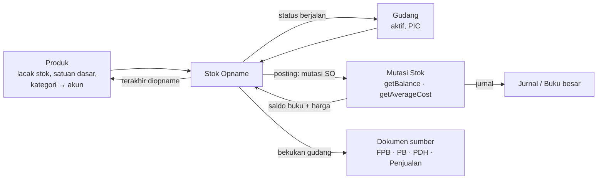
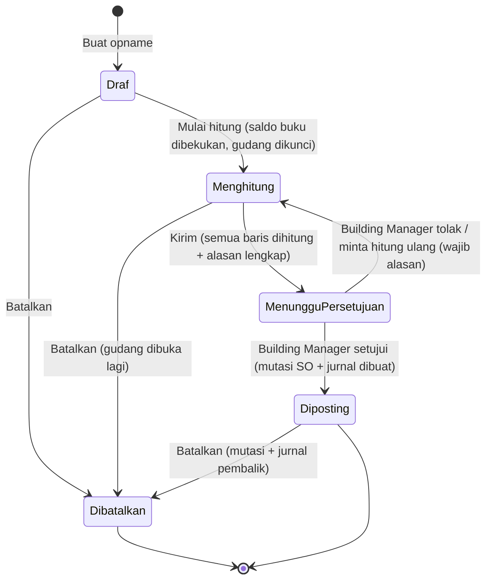
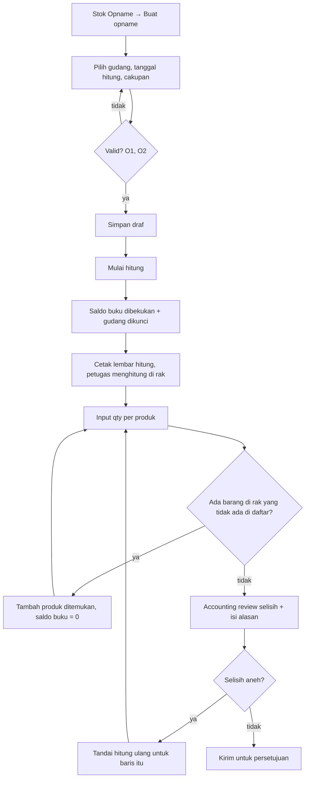
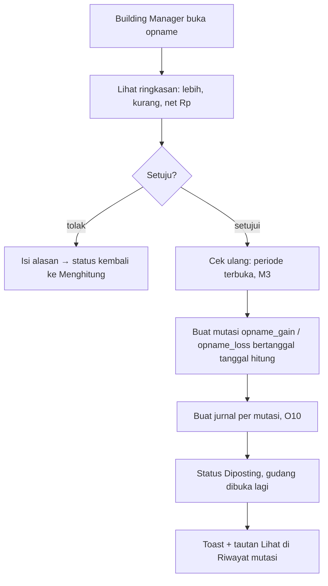

# Spesifikasi Fitur: Stok Opname

> Acuan untuk membangun menu **Stok Opname** di aplikasi Jurnal ProApps. Halamannya ada di `#gudang/tab/opname` dan saat ini masih placeholder.
>
> Dokumen ini lanjutan dari `gudang-spec.md` dan `mutasi-stok-spec.md`. Stok opname **menghitung fisik barang di satu gudang, membandingkannya dengan saldo buku, lalu memposting selisihnya** sebagai mutasi SO beserta jurnal penyesuaian.

---

## 0. Aturan wajib untuk implementasi

1. **Pakai style dan komponen yang sudah ada.** Ikuti pola Gudang dan Mutasi Stok: page header card, kartu ringkasan, toolbar filter, tabel, badge status, menu ⋯, dialog, drawer, toast, tab, `DocNumber`, `DateField`, `BackLink`. Jangan membuat komponen, warna, atau font baru.
2. **Satu sumber data.**
   - Saldo buku dibaca dengan `getBalance` dan harga dengan `getAverageCost` dari `stock.js`.
   - Hasil posting adalah mutasi biasa (`opname_gain` / `opname_loss`) yang masuk ke kumpulan mutasi yang sama.
   - Jangan membuat penyimpanan saldo baru.
3. **Alur approval memakai pola Pindah Barang:** peran "Lihat sebagai", Building Manager (Budi Hartono), riwayat persetujuan, serta tombol setujui dan tolak.
4. Bahasa UI Indonesia dengan sentence case.

---

## 1. Prinsip desain

- **Satu opname = satu gudang = satu tanggal hitung (cut-off).** Kalau ada beberapa gudang, buat dokumen terpisah.
- **Hitung buta (blind count).** Petugas yang menghitung tidak melihat saldo buku, supaya angkanya jujur. Saldo buku dan selisih hanya terlihat oleh Accounting dan Building Manager.
- **Gudang dibekukan selama opname berjalan.** Tidak ada barang masuk atau keluar di gudang itu sampai opname diposting atau dibatalkan, supaya saldo buku tidak bergeser di tengah hitungan.
- **Selisih tidak pernah diedit langsung ke stok.** Selisih masuk ke stok hanya lewat posting dokumen opname, yang membuat mutasi SO dan jurnal. Koreksi setelah posting dilakukan dengan membatalkan dokumen, yang membuat mutasi pembalik (M2).
- Setiap angka bisa ditelusuri: opname → baris produk → mutasi SO → jurnal.

---

## 2. Aturan bisnis dan akuntansi

| No | Aturan | Alasan | Dampak ke UI |
|---|---|---|---|
| O1 | Opname dibuat per **gudang aktif**. Satu gudang hanya boleh punya **satu opname berjalan** | Hitungan tidak boleh tumpang tindih | Gudang yang sedang diopname ditandai di dropdown: "Sedang diopname (SO/…)" dan tidak bisa dipilih |
| O2 | **Tanggal hitung** tidak boleh di masa depan, tidak boleh di periode terkunci, dan tidak boleh lebih awal dari mutasi terakhir di gudang itu | Saldo buku pada cut-off harus final | Pesan: "Ada mutasi di {gudang} tanggal {tgl}. Pilih tanggal {tgl} atau sesudahnya" |
| O3 | Saat opname **dimulai**, saldo buku setiap produk dibekukan sebagai `bookQty` = `getBalance(produk, gudang, tanggal hitung)` | Pembanding harus tetap walaupun hitungan makan waktu berhari-hari | Kolom "Saldo buku" tidak berubah setelah opname dimulai |
| O4 | Selama status **Menghitung** sampai **Menunggu persetujuan**, semua dokumen yang membuat mutasi di gudang itu **ditolak**: penerimaan barang, pengeluaran, pindah barang (asal maupun tujuan), dan penjualan. Termasuk dokumen yang **sudah diajukan sebelum opname dimulai**: pindah barang yang menunggu approval tidak bisa **disetujui**, dan dokumen yang sudah selesai tidak bisa **dibatalkan** (pembatalan juga membuat mutasi) | Pembekuan (lihat prinsip). Tanpa ini, barang pindahan masuk ke gudang setelah saldo buku dibekukan dan selisihnya salah dijurnal sebagai opname lebih | Pesan di dokumen sumber: "{gudang} sedang diopname ({SO/…}). Selesaikan atau batalkan opname dulu" + tautan |
| O5 | **Selisih** = qty hitung − saldo buku. Plus berarti barang lebih, minus berarti barang kurang | — | Plus berwarna hijau dengan tanda +, minus merah |
| O6 | Nilai selisih = selisih × **harga rata-rata pada tanggal hitung** (`getAverageCost`, M4/M6). Kalau produk belum punya harga (belum pernah ada mutasi masuk), Accounting **wajib mengisi harga satuan** untuk selisih plus | Kaidah penilaian rata-rata tertimbang | Kolom harga terkunci, kecuali untuk kasus tanpa harga |
| O7 | Semua baris harus **sudah dihitung** sebelum dikirim untuk persetujuan. Baris yang barangnya memang tidak ada diisi **0**, bukan dibiarkan kosong | Kosong ≠ nol | Tombol "Kirim untuk persetujuan" nonaktif dengan tooltip "{n} produk belum dihitung" |
| O8 | Setiap baris dengan selisih ≠ 0 **wajib punya alasan**. Alasan yang boleh dipilih tergantung arah selisih: **kurang** → Rusak, Kedaluwarsa, Hilang, Salah catat, Lainnya. **Lebih** → Ditemukan, Salah catat, Lainnya. Lainnya wajib diberi catatan | Jejak audit, bahan perbaikan proses, dan menentukan akun jurnal (O10) | Dropdown alasan hanya berisi pilihan yang sesuai arah selisih. Error di baris: "Pilih alasan selisih" |
| O9 | **Posting** (setelah disetujui Building Manager) membuat satu mutasi per baris yang selisihnya ≠ 0, bertanggal **tanggal hitung**: `opname_gain` (masuk) atau `opname_loss` (keluar) | Mutasi lahir dari dokumen (M1) | Baris dengan selisih 0 tidak membuat mutasi, tetapi tetap tercatat di dokumen sebagai bukti sudah dihitung |
| O10 | **Akun selisih ditentukan oleh alasan** (lihat tabel "Akun selisih per alasan" di bawah). Jurnal per mutasi: **lebih** → Dr Persediaan / Cr {akun alasan}. **Kurang** → Dr {akun alasan} / Cr Persediaan. Akun Persediaan diambil dari kategori produk | Auditor membedakan susut wajar (beban operasional), kehilangan (beban lain-lain), dan koreksi pencatatan. Satu akun untuk semuanya menyembunyikan kehilangan | Tombol "Lihat jurnal" di detail opname dan di Riwayat mutasi. Ringkasan selisih dikelompokkan per akun |
| O11 | **Batalkan** opname: sebelum posting cukup ubah status, tanpa efek ke stok. Setelah posting akan membuat mutasi dan jurnal pembalik (M2) dan **wajib diisi alasan pembatalan**, dengan syarat stok tidak menjadi minus (M3), termasuk pemakaian oleh dokumen setelah tanggal opname. Bila periode opname sudah dikunci, pembalik bertanggal hari ini | Jejak audit | Dialog konfirmasi berisi jumlah mutasi yang akan dibalik + textarea alasan (wajib, setelah posting). Alasan tercatat di tab Riwayat |
| O12 | Pemisahan tugas: **Petugas Gudang** menghitung, **Accounting** mereview dan mengisi alasan, **Building Manager** menyetujui. Accounting boleh ikut menghitung | Kontrol internal | Tombol yang tampil menyesuaikan peran "Lihat sebagai" |
| O13 | Kolom harga dan nilai mengikuti `canViewInventoryValue` (M11) | Sama dengan Gudang dan Mutasi | — |
| O14 | Hanya produk dengan **Lacak stok = ya** yang ikut opname (M12) | — | — |

### Akun selisih per alasan (O10)

| Alasan | Arah | Akun default | Kelompok di Laba Rugi | Alasan akuntansi |
|---|---|---|---|---|
| Rusak | Kurang | **6-60006 Beban Kerusakan Persediaan** (akun baru) | Beban operasional | Susut wajar dari kegiatan operasional |
| Kedaluwarsa | Kurang | **6-60006 Beban Kerusakan Persediaan** (akun baru) | Beban operasional | Sama dengan rusak |
| Hilang | Kurang | **8-10006 Beban Kehilangan Persediaan** (akun baru) | Beban lain-lain | Tidak wajar, harus terlihat terpisah dan ditindaklanjuti |
| Salah catat | Kurang / lebih | **8-10001 Penyesuaian Persediaan** (sudah ada) | Beban/pendapatan lain-lain | Koreksi pencatatan, bukan kejadian fisik |
| Ditemukan | Lebih | **8-10001 Penyesuaian Persediaan** | Pendapatan lain-lain (saldo kredit) | Barang yang sebelumnya tidak tercatat |
| Lainnya | Kurang / lebih | **8-10001 Penyesuaian Persediaan** | Lain-lain | Penampung, wajib ada catatan |

- **Dua akun baru ditambahkan ke COA:** 6-60006 Beban Kerusakan Persediaan (Beban, saldo normal debit) dan 8-10006 Beban Kehilangan Persediaan (Beban Lain-lain, saldo normal debit). Kode mengikuti urutan terakhir di COA prototipe. Sesuaikan bila sudah dipakai.
- **Pemetaan bisa diubah** di **Pengaturan › Persediaan › Akun selisih opname**: satu baris per alasan dengan pilihan akun. Pilihan hanya berisi **sub-akun yang bisa dijurnal (bukan akun induk)** dan disaring sesuai arah alasan: alasan **kurang** (Rusak, Kedaluwarsa, Hilang) → akun Beban atau Beban lain-lain; **Ditemukan** → Pendapatan lain-lain atau Beban lain-lain (8-10001); Salah catat dan Lainnya (dua arah) → ketiganya. Akun yang dipakai dikunci ke dokumen saat diposting, jadi perubahan pemetaan tidak mengubah opname lama.
- **Bila akun sebuah alasan belum diatur atau dinonaktifkan,** posting ditolak: "Akun untuk alasan {alasan} belum diatur" + tautan ke Pengaturan. Jangan diam-diam memakai 8-10001.
- **Satu opname bisa menghasilkan beberapa akun.** Contoh: 2 rusak + 1 hilang + 3 ditemukan menghasilkan jurnal ke tiga akun berbeda. Setiap baris tetap satu mutasi dan satu jurnal.

---

## 3. Information Architecture

```
Persediaan
└── Stok Opname  (#gudang/tab/opname)
    ├── Page header: "Stok Opname" + deskripsi + [Buat opname]
    ├── Kartu ringkasan: Sedang berjalan · Menunggu persetujuan · Selisih bulan ini (Rp, net)
    ├── Toolbar: cari no. dokumen · Gudang · Status · Rentang tanggal
    └── Tabel: No. dokumen · Tanggal hitung · Gudang · Status · Progres (x/y dihitung)
              · Produk selisih · Nilai selisih* · Dibuat oleh · ⋯

Buat opname  (drawer atau halaman #gudang/opname/new)
    ├── Gudang* (hanya gudang aktif yang tidak sedang diopname)
    ├── Tanggal hitung* (default hari ini, aturan O2)
    ├── Cakupan*: Semua produk di gudang ini · Per kategori · Pilih produk
    ├── Petugas hitung (user) · Catatan
    └── [Simpan draf]  [Mulai hitung]

Detail opname  (#gudang/opname/<id>)
    ├── BackLink "Stok Opname"
    ├── Header: no. dokumen, badge status, gudang, tanggal hitung, petugas
    ├── Stepper: Draf → Menghitung → Menunggu persetujuan → Diposting
    ├── Banner sesuai status (contoh: "Gudang Utama dibekukan sampai opname ini selesai")
    ├── Aksi utama per status (lihat bagian 4)
    ├── Tab Hitung
    │   └── Tabel: Produk · Satuan · Saldo buku** · Qty hitung (input) · Selisih** · Alasan** · Catatan
    │       + cari produk, filter "Belum dihitung / Ada selisih / Semua"
    │       + [Tambah produk ditemukan] untuk barang yang ada di rak tapi tidak ada di daftar
    ├── Tab Ringkasan selisih** (setelah semua dihitung)
    │   └── Kartu: Lebih (qty, Rp) · Kurang (qty, Rp) · Net (Rp)
    │       + tabel per akun: Akun · Alasan · Jumlah produk · Debit · Kredit (pratinjau jurnal sebelum posting)
    │       + tabel baris yang selisih ≠ 0, dengan [Lihat jurnal] setelah diposting
    └── Tab Riwayat: dibuat, mulai hitung, dikirim, disetujui/ditolak (dengan alasan), diposting, dibatalkan

Cetak
    ├── Lembar hitung: daftar produk + kolom kosong untuk qty, TANPA saldo buku
    └── Berita acara stok opname: ringkasan selisih per alasan dan per akun + tanda tangan Petugas, Accounting, Building Manager

*  hanya untuk peran dengan canViewInventoryValue
** disembunyikan untuk peran Gudang (blind count)
```

---

## 3a. Integrasi dengan Mutasi Stok, Gudang, dan Produk (wajib)

Stok Opname **tidak punya data stok sendiri**. Semua angka dibaca dari Mutasi Stok, gudang dari master Gudang, dan produk dari master Produk. Hasilnya ditulis kembali ke Mutasi Stok. Kalau satu sambungan di bawah tidak dibuat, angka antar menu akan berbeda.



### Mutasi Stok

| Arah | Yang harus terjadi |
|---|---|
| Mutasi → Opname | `bookQty` diambil dari `getBalance(produk, gudang, tanggal hitung)`, dan `unitCost` dari `getAverageCost(produk, tanggal hitung)`. Dilarang menghitung saldo dengan cara lain |
| Mutasi → Opname | Validasi O2 memakai mutasi terakhir di gudang itu (`listMoves({ warehouseId })`) |
| Opname → Mutasi | Posting menambah `StockMove` `opname_gain`/`opname_loss` dengan `sourceType: "stock_opname"`, `sourceNo` = nomor SO, tanggal = tanggal hitung |
| Opname → Mutasi | Pembatalan setelah posting menambah mutasi pembalik (`reversalOfId`) dengan badge "Pembatalan" |
| Di Mutasi Stok | **Saldo stok:** angka langsung berubah setelah posting. Indikator rekonsiliasi tetap "Cocok dengan buku besar" |
| Di Mutasi Stok | **Riwayat mutasi:** filter jenis "Penyesuaian opname (lebih/kurang)" diaktifkan. No. dokumen SO membuka detail opname. "Lihat jurnal" menampilkan jurnal O10 |
| Di Mutasi Stok | **Kartu stok:** baris SO tampil dengan saldo berjalan yang benar. No. dokumen membuka detail opname |
| Di Mutasi Stok | **Pindah barang:** gudang yang sedang diopname tidak bisa dipilih sebagai asal maupun tujuan (O4), dan muncul pesan beserta tautan ke opname |

### Gudang

| Arah | Yang harus terjadi |
|---|---|
| Gudang → Opname | Dropdown gudang hanya berisi gudang **aktif**. Gudang yang sedang diopname tampil nonaktif dengan keterangan "Sedang diopname (SO/…)" |
| Opname → Gudang | **Banner** "Stok opname {SO/…} masih berjalan" + [Buka opname] di daftar dan detail gudang. Pakai `runningOpnameOf` yang sudah ada, diubah untuk membaca status `counting` dan `pending_approval` |
| Opname → Gudang | **R5:** gudang tidak bisa dinonaktifkan selama opname berjalan. Dialog alasan menyertakan tautan ke opname |
| Opname → Gudang | **R3/R4 (`hasTransactions`):** gudang yang pernah diopname dianggap sudah dipakai, jadi tidak bisa dihapus dan kodenya terkunci. Sudah ada di `selectors.js`, tinggal dipertahankan |
| Opname → Gudang | **Detail gudang:** info "Opname terakhir: {tanggal} · {SO/…}" (yang diposting) dan tombol [Buat opname] yang membuka form dengan gudang ini terpilih |
| Opname → Gudang | **Tab Stok** di detail gudang: angka berubah setelah posting, karena membaca `getBalance` yang sama |
| Opname → Gudang | **Tab Mutasi terakhir:** baris SO tampil |

### Produk

| Arah | Yang harus terjadi |
|---|---|
| Produk → Opname | Hanya produk dengan **Lacak stok = ya** yang masuk cakupan. Produk jasa atau non-stok tidak pernah muncul |
| Produk → Opname | Cakupan "Semua produk di gudang ini" = semua produk Lacak stok yang **pernah punya mutasi** di gudang itu, termasuk yang saldonya 0 |
| Produk → Opname | Cakupan "Per kategori" memakai **Kategori Produk** yang sama dengan master |
| Produk → Opname | Qty memakai **satuan dasar** produk (M9). Validasi bilangan bulat mengikuti satuannya |
| Produk → Opname | Akun Persediaan untuk jurnal diambil dari **kategori produk**. Kalau akun kategori belum diatur, posting ditolak: "Akun persediaan untuk kategori {kategori} belum diatur" + tautan |
| Produk → Opname | "Tambah produk ditemukan" hanya bisa memilih produk yang sudah ada di master. Kalau belum ada, buat dulu di Produk |
| Opname → Produk | **Detail produk › Stok per gudang:** qty berubah setelah posting. Tambah kolom atau keterangan "Terakhir diopname {tanggal}" per gudang |
| Opname → Produk | Selama produk ada di opname yang berjalan, **Lacak stok** dan **Satuan dasar** produk itu tidak bisa diubah: "Produk sedang dihitung di {SO/…}" |
| Opname → Produk | Produk yang pernah diopname dianggap sudah bertransaksi: tidak bisa dihapus, hanya diarsipkan |

### Dokumen sumber lain

| Dokumen | Yang harus terjadi |
|---|---|
| Penerimaan barang (FPB) | Ditolak bila gudang tujuannya sedang diopname (O4) |
| Pengeluaran barang | Ditolak bila gudangnya sedang diopname |
| Pindah barang | Ditolak bila gudang asal **atau** tujuan sedang diopname. Berlaku untuk buat baru, **setujui** pengajuan yang dibuat sebelum opname, dan **batalkan** pindah barang yang sudah selesai. Tombolnya disembunyikan dan diganti banner "{gudang} sedang diopname ({SO/…})" |
| Penjualan (bila sudah memakai stok) | Ditolak bila gudangnya sedang diopname |
| Semua dokumen di atas | Pengecekan memakai satu fungsi `isWarehouseFrozen()`, bukan ditulis ulang di tiap dokumen |
| Inbox persetujuan (bila ada) | Opname yang menunggu persetujuan ikut tampil untuk Building Manager |

---

## 4. User flow

### A. Siklus status



| Status | Badge | Siapa bisa apa |
|---|---|---|
| Draf | abu | Accounting: ubah, Mulai hitung, Hapus draf |
| Menghitung | biru | Gudang/Accounting: isi qty, Cetak lembar hitung. Accounting: isi alasan, Kirim untuk persetujuan, Batalkan |
| Menunggu persetujuan | oranye | Building Manager: Setujui & posting, Tolak (dengan alasan). Yang lain hanya baca |
| Diposting | hijau | Semua: Cetak berita acara, Lihat jurnal. Accounting: Batalkan |
| Dibatalkan | merah | Hanya baca |

Status `berjalan` di seed prototipe sekarang = Menghitung atau Menunggu persetujuan. `runningOpnameOf` harus memeriksa kedua status itu.

### B. Membuat dan menghitung



- Input qty tersimpan otomatis per baris (seperti form lain di prototipe) dan bisa dilanjutkan di hari lain.
- "Hitung ulang" mengosongkan qty baris terpilih dan memberi badge "Hitung ulang" sampai baris itu diisi lagi.

### C. Persetujuan dan posting



### D. Membatalkan opname yang sudah diposting

1. Accounting membuka detail → ⋯ → Batalkan opname.
2. Dialog: "Pembatalan akan membuat {n} mutasi pembalik dan jurnal pembalik. Stok {gudang} kembali ke saldo buku sebelum opname." Wajib isi alasan.
3. Sistem cek M3 (stok tidak boleh minus setelah dibalik) dan kunci periode. Kalau gagal, tampilkan produk yang bermasalah.
4. Mutasi pembalik bertanda "Pembatalan" muncul di Riwayat mutasi.

---

## 5. Validasi dan teks UI

### Form buat opname
| Field | Aturan | Pesan |
|---|---|---|
| Gudang | Wajib, aktif, tidak sedang diopname | "Pilih gudang" · "Gudang ini sedang diopname ({SO/…})" |
| Tanggal hitung | Wajib, O2 | "Tanggal tidak boleh di masa depan" · "Periode {bulan} sudah dikunci" · "Ada mutasi di {gudang} tanggal {tgl}. Pilih tanggal {tgl} atau sesudahnya" |
| Cakupan per kategori | Minimal 1 kategori | "Pilih minimal satu kategori" |
| Cakupan pilih produk | Minimal 1 produk | "Pilih minimal satu produk" |
| Hasil cakupan | Minimal 1 produk Lacak stok = ya | "Tidak ada produk yang bisa dihitung di cakupan ini" |

### Tab Hitung
| Kasus | Pesan |
|---|---|
| Qty negatif atau bukan angka | "Qty tidak boleh negatif" |
| Desimal untuk satuan bulat (pcs, rim) | "Qty harus bilangan bulat untuk satuan {satuan}" |
| Selisih ≠ 0 tanpa alasan | "Pilih alasan selisih" |
| Alasan Lainnya tanpa catatan | "Tulis catatan untuk alasan Lainnya" |
| Alasan tidak cocok dengan arah selisih (mis. Hilang pada selisih lebih) | Dropdown tidak menampilkannya. Bila qty diubah sehingga arah berbalik, alasan dikosongkan: "Arah selisih berubah, pilih alasan lagi" |
| Akun alasan belum diatur (saat posting) | "Akun untuk alasan {alasan} belum diatur" + [Atur di Pengaturan] |
| Produk tanpa harga, selisih plus | "Isi harga satuan, produk ini belum punya harga rata-rata" |

### Dialog
| Aksi | Judul | Isi | Tombol |
|---|---|---|---|
| Mulai hitung | Mulai hitung {gudang}? | "Saldo buku per {tgl} akan dibekukan. Selama opname berjalan, {gudang} tidak bisa menerima atau mengeluarkan barang." | Batal · Mulai hitung |
| Kirim | Kirim untuk persetujuan? | "{x} produk dihitung, {y} produk selisih, net {Rp}." | Batal · Kirim |
| Tolak (BM) | Tolak opname | Textarea alasan (wajib) | Batal · Tolak |
| Setujui (BM) | Setujui dan posting? | "Akan dibuat {n} mutasi penyesuaian dan jurnalnya per {tgl}. Tindakan ini tidak bisa diubah, hanya dibatalkan." | Batal · Setujui & posting |
| Batalkan (sebelum posting) | Batalkan opname? | "Hasil hitungan tidak dipakai dan {gudang} dibuka lagi." | Kembali · Batalkan opname |
| Batalkan (setelah posting) | Batalkan {SO/…}? | "Pembatalan akan membuat {n} mutasi pembalik beserta jurnalnya. Stok {gudang} kembali ke saldo buku sebelum opname." + textarea **Alasan pembatalan** (wajib, error "Alasan pembatalan wajib diisi") | Kembali · Batalkan opname |

### Toast
- "Opname {SO/…} dimulai. {gudang} dibekukan."
- "Opname dikirim ke Building Manager"
- "Opname {SO/…} diposting: {n} mutasi penyesuaian dibuat" + [Lihat mutasi]
- "Opname {SO/…} ditolak dan dikembalikan ke petugas"
- "Opname {SO/…} dibatalkan"

---

## 6. Model data (prototipe)

```ts
type StockOpnameStatus =
  | "draft" | "counting" | "pending_approval" | "posted" | "cancelled";

type OpnameReason =
  | "rusak" | "hilang" | "kedaluwarsa" | "salah_catat" | "ditemukan" | "lainnya";

type StockOpname = {
  id: string;
  number: string;              // SO/2026/11/0003 (ikuti Penomoran Dokumen)
  warehouseId: string;
  date: string;                // tanggal hitung / cut-off (YYYY-MM-DD)
  scope: { type: "all" | "category" | "manual"; categoryIds?: string[]; productIds?: string[] };
  counterUserId?: string;      // petugas hitung
  notes?: string;
  status: StockOpnameStatus;
  lines: StockOpnameLine[];    // dibentuk saat Mulai hitung
  history: { at: string; userId: string; action: string; note?: string }[];
  startedAt?: string;
  postedAt?: string;
  cancelledAt?: string;
  createdBy: string;
  createdAt: string;
};

type StockOpnameLine = {
  productId: string;
  bookQty: number;             // dibekukan saat Mulai hitung (O3)
  countedQty: number | null;   // null = belum dihitung (O7)
  unitCost: number;            // getAverageCost pada tanggal hitung (O6)
  reason?: OpnameReason;
  note?: string;
  isFound?: boolean;           // ditambahkan lewat "Tambah produk ditemukan"
  needsRecount?: boolean;
  countedBy?: string;
  countedAt?: string;
};
// Turunan: diffQty = countedQty - bookQty; diffValue = diffQty * unitCost
```

- Mutasi hasil posting memakai `StockMove` yang sudah ada: `type` = `opname_gain` / `opname_loss`, `sourceType` = `"stock_opname"`, `sourceId` = id opname, `sourceNo` = nomor opname, `date` = tanggal hitung.
- Mutasi opname menyimpan alasan dan akunnya: tambah field `adjustmentReason?: OpnameReason` dan `adjustmentAccount?: string` di `StockMove`. Akun dikunci saat posting.
- `moveJournal` di `journal.js`: case `opname_gain` dan `opname_loss` memakai `move.adjustmentAccount`, bukan `AKUN.selisih` yang tetap. `AKUN.selisih` (8-10001) hanya default untuk Salah catat, Ditemukan, dan Lainnya.
- Pengaturan pemetaan:
  ```ts
  type OpnameAccountMap = Record<OpnameReason, string>; // kode akun
  // default: { rusak: "6-60006", kedaluwarsa: "6-60006", hilang: "8-10006",
  //            salah_catat: "8-10001", ditemukan: "8-10001", lainnya: "8-10001" }
  ```
- Ganti `stockOpnamesSeed` lama (`status: 'berjalan'`) dengan bentuk di atas.

### Fungsi bersama (tambahkan ke `stock.js`)

```ts
runningOpnameOf(opnames, warehouseId)          // status counting | pending_approval
isWarehouseFrozen(opnames, warehouseId)        // dipakai semua dokumen sumber (O4)
buildOpnameLines(moves, products, warehouseId, date, scope) // bookQty + unitCost
opnameSummary(opname)                          // dihitung, selisih, lebih/kurang/net Rp
postOpname(opname, moves)                      // → mutasi baru (O9)
reverseOpname(opname, moves)                   // → mutasi pembalik (O11)
```

### Seed opname

| No. dokumen | Gudang | Tanggal | Status | Isi |
|---|---|---|---|---|
| SO/2026/06/0001 | Gudang Utama | 30 Jun 2026 | Diposting | Kertas A4 dan Map plastik, **selisih 0 semua** (bukti opname rutin tanpa mengubah seed mutasi) |
| SO/2026/11/0003 | **Gudang Lt. 2** | 20 Nov 2026 | Menghitung | Kertas A4 80 gsm, saldo buku 10 rim, belum dihitung. Untuk tes input, selisih, dan approval |

- Opname berjalan dipindah dari Gudang Utama ke **Gudang Lt. 2**. Seed lama (Gudang Utama, 3 Nov) bertentangan dengan O4, karena masih ada pindah barang dari Gudang Utama tanggal 4 Nov.
- Tanggal 20 Nov dipilih karena mutasi terakhir di Gudang Lt. 2 tanggal 2 Nov (O2).
- Banner di detail Gudang Lt. 2 harus tampil. Banner di Gudang Utama hilang.

---

## 7. Kriteria penerimaan

- [ ] Placeholder Stok Opname diganti dengan daftar opname, kartu ringkasan, dan toolbar filter.
- [ ] Semua UI memakai komponen dan style yang sudah ada.
- [ ] Buat opname memvalidasi O1 dan O2. Gudang yang sedang diopname tidak bisa dipilih.
- [ ] **Mulai hitung** membekukan saldo buku (O3). Saldo buku tidak berubah walau tanggal sistem bergeser.
- [ ] Selama opname berjalan, FPB, pengeluaran, pindah barang (asal/tujuan), dan penjualan ke gudang itu **ditolak** dengan pesan O4 dan tautan ke opname.
- [ ] Peran **Gudang** tidak melihat Saldo buku, Selisih, Harga, dan Nilai (blind count). Accounting dan Building Manager melihat semuanya.
- [ ] Tombol Kirim nonaktif sampai semua baris dihitung (O7) dan semua selisih punya alasan (O8).
- [ ] Tambah produk ditemukan berfungsi: saldo buku 0, selisih plus, harga diisi bila produk belum punya harga (O6).
- [ ] Building Manager bisa menyetujui atau menolak. Tolak mengembalikan status ke Menghitung dengan alasan di Riwayat.
- [ ] Posting membuat mutasi `opname_gain`/`opname_loss` bertanggal tanggal hitung, hanya untuk baris dengan selisih ≠ 0. Mutasi itu muncul di Riwayat mutasi, Kartu stok, saldo Gudang, dan Stok per gudang di Produk.
- [ ] Jurnal posting sesuai O10 dan seimbang. Setelah posting, indikator rekonsiliasi di Mutasi Stok tetap "Cocok dengan buku besar".
- [ ] **Akun per alasan:** dua akun baru (6-60006, 8-10006) ada di Daftar Akun. Rusak/Kedaluwarsa dijurnal ke 6-60006, Hilang ke 8-10006, dan Salah catat/Ditemukan/Lainnya ke 8-10001.
- [ ] Dropdown alasan mengikuti arah selisih (Hilang tidak muncul untuk selisih lebih, Ditemukan tidak muncul untuk selisih kurang).
- [ ] Tab Ringkasan selisih menampilkan pratinjau jurnal per akun sebelum posting, dan angkanya sama dengan jurnal setelah posting.
- [ ] Mengubah pemetaan di Pengaturan tidak mengubah jurnal opname yang sudah diposting.
- [ ] Posting ditolak bila akun sebuah alasan belum diatur.
- [ ] Uji campuran: satu opname dengan 1 baris Rusak, 1 baris Hilang, dan 1 baris Ditemukan menghasilkan tiga jurnal ke tiga akun berbeda, dan semuanya seimbang.
- [ ] Batalkan setelah posting membuat mutasi dan jurnal pembalik, dengan cek M3 dan kunci periode.
- [ ] Batalkan setelah posting wajib mengisi alasan, dan alasannya muncul di kolom Catatan tab Riwayat.
- [ ] Pilihan akun di Pengaturan tidak memuat akun induk (mis. 6-10000, 8-10000) dan disaring per arah alasan.
- [ ] Lembar hitung tercetak **tanpa** saldo buku. Berita acara tercetak dengan ringkasan selisih dan tiga kolom tanda tangan.
- [ ] Banner "Stok opname … masih berjalan" di Gudang mengikuti seed baru (Gudang Lt. 2), dan R5 memblokir nonaktif gudang itu.
- [ ] Filter jenis "Penyesuaian opname" di Riwayat mutasi diaktifkan lagi.
- [ ] Contoh uji: di SO/2026/11/0003 isi Kertas A4 = 9 rim, alasan Hilang, kirim, lalu setujui sebagai Building Manager. Hasil yang diharapkan:
  - Kertas A4 di Gudang Lt. 2 menjadi 9 rim.
  - Mutasi keluar 1 rim × harga rata-rata saat itu (di prototipe sekarang Rp 56.800, setelah revisi harga perolehan).
  - Jurnal (alasan Hilang): Dr **8-10006 Beban Kehilangan Persediaan** Rp 56.800 / Cr 1-10300 Persediaan Rp 56.800.
  - Total nilai persediaan turun Rp 56.800 dan tetap cocok dengan buku besar.

### Integrasi (cek setelah contoh uji di atas)

**Mutasi Stok**
- [ ] Saldo buku di opname sama persis dengan angka di Mutasi Stok › Saldo stok untuk gudang dan tanggal yang sama.
- [ ] Setelah posting, Saldo stok Kertas A4 di Gudang Lt. 2 menjadi 9, dan total nilai serta indikator rekonsiliasi tetap cocok.
- [ ] Riwayat mutasi menampilkan baris SO/2026/11/0003 jenis "Penyesuaian opname (kurang)". Klik no. dokumen membuka detail opname, dan Lihat jurnal menampilkan jurnal O10.
- [ ] Kartu stok Kertas A4 › Gudang Lt. 2 menampilkan baris SO dengan saldo berjalan 10 → 9.
- [ ] Selama SO berjalan, membuat pindah barang dari atau ke Gudang Lt. 2 ditolak dengan pesan O4.
- [ ] Pindah barang ke Gudang Lt. 2 yang diajukan **sebelum** SO dimulai tidak bisa disetujui selama SO berjalan, dan pindah barang yang sudah selesai tidak bisa dibatalkan.
- [ ] Kartu stok per gudang menilai saldo sebagai qty × harga rata-rata gabungan (M6), sehingga nilainya sama dengan detail Gudang dan jumlah semua gudang sama dengan kartu "Semua gudang".
- [ ] Membatalkan SO yang sudah diposting membuat mutasi pembalik, dan saldo kembali 10.

**Gudang**
- [ ] Banner "Stok opname SO/2026/11/0003 masih berjalan" tampil di Gudang Lt. 2, dan hilang setelah posting atau pembatalan.
- [ ] Nonaktifkan Gudang Lt. 2 selama opname berjalan ditolak, dan dialog alasannya menautkan ke opname.
- [ ] Detail Gudang Lt. 2 menampilkan "Opname terakhir" setelah posting, dan tab Stok serta Mutasi terakhir ikut berubah.
- [ ] Tombol Buat opname dari detail gudang membuka form dengan gudang terpilih.
- [ ] Gudang nonaktif dan gudang yang sedang diopname tidak bisa dipilih di form Buat opname.

**Produk**
- [ ] Produk jasa atau Lacak stok = tidak tidak muncul di cakupan opname mana pun.
- [ ] Cakupan per kategori hanya memuat produk dari kategori yang dipilih.
- [ ] Detail Produk Kertas A4 › Stok per gudang menampilkan qty baru (Gudang Lt. 2 = 9) dan "Terakhir diopname 20 Nov 2026".
- [ ] Selama opname berjalan, mengubah Lacak stok atau Satuan dasar Kertas A4 ditolak dengan pesan "Produk sedang dihitung di SO/…".
- [ ] Posting ditolak dengan pesan dan tautan bila akun persediaan kategori produk belum diatur.

---

## 8. Di luar cakupan

- **Pembekuan untuk pengeluaran barang dan penjualan** sudah menjadi aturan (O4), tetapi kedua dokumen itu belum membuat mutasi stok di prototipe. Terapkan `isWarehouseFrozen()` saat fiturnya dibuat.
- **Format cetak** lembar hitung dan berita acara: prototipe masih memakai cetak halaman biasa. Format khusus menyusul.
- **Laporan persediaan** (ringkasan opname, selisih per periode) dibahas terpisah di menu Laporan.

- Opname bergilir otomatis (cycle count terjadwal per kategori/ABC).
- Hitung lewat scan barcode atau aplikasi mobile.
- Opname banyak gudang dalam satu dokumen.
- Batas nilai approval bertingkat (misalnya selisih di atas Rp x perlu Direktur). Untuk sekarang semua opname disetujui Building Manager.
- Opname per lokasi rak/bin di dalam gudang.
